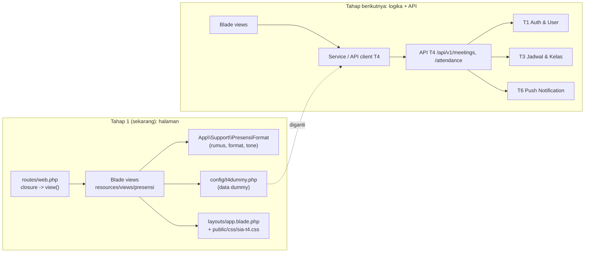
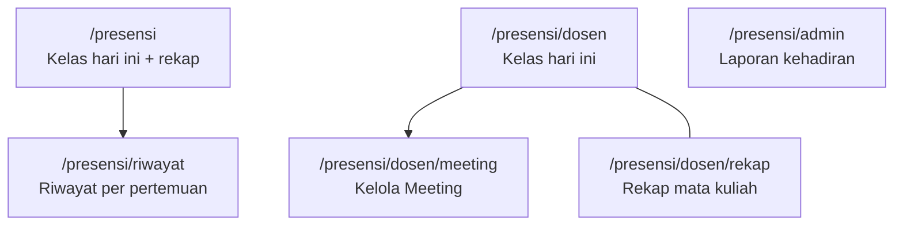
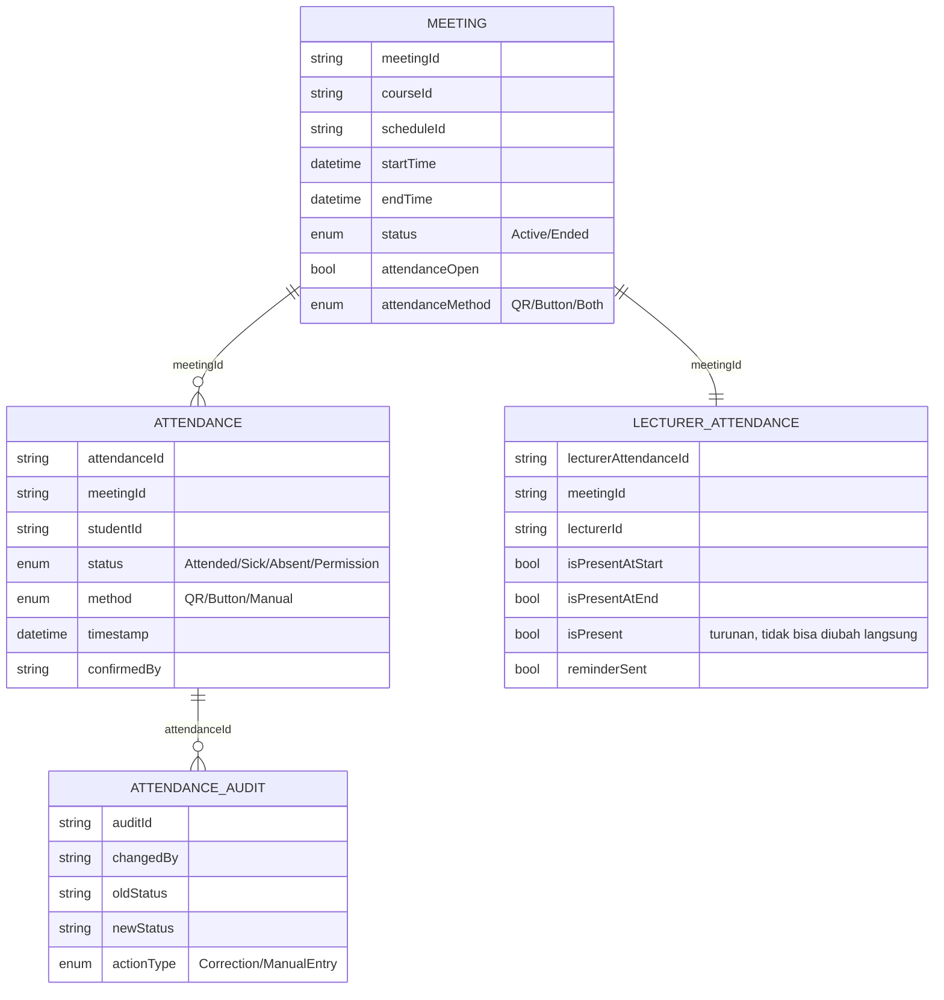
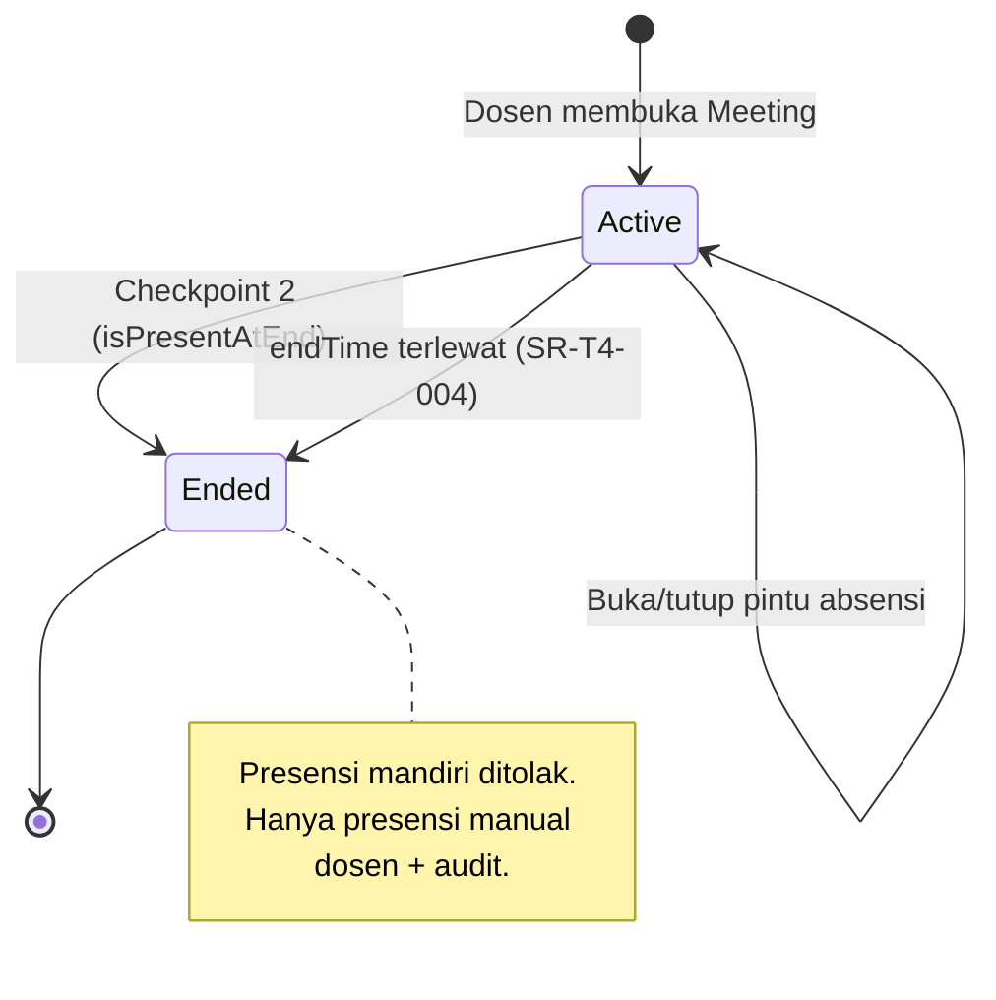

# Arsitektur T4 — Modul Presensi

Dokumen ini menjelaskan susunan kode saat ini (tahap halaman) dan arah ke tahap logika/API.

## 1. Arsitektur saat ini dan target



Prinsip: view tidak tahu asal data. Pada tahap berikutnya hanya sumber data (`config('t4dummy...')`) yang diganti service/API, bentuk array dibuat sama dengan kontrak API.

## 2. Struktur folder

```text
routes/web.php                         # route halaman T4 (closure -> view)
config/t4dummy.php                     # data dummy (Meeting, rekap, mahasiswa)
app/Support/PresensiFormat.php         # rumus persen, format ID, ambang, tone badge
public/css/sia-t4.css                  # token + komponen dari 00 Foundation
resources/views/layouts/app.blade.php  # top bar Gaya B, peluncur modul
resources/views/presensi/
  _badge, _icon, _tabs, _devstates     # partial
  index, riwayat                       # mahasiswa
  dosen/index, meeting, rekap          # dosen
  admin/index                          # BAAK/Prodi
tests/Unit/Presensi/PresensiFormatTest.php
tests/Feature/Presensi/HalamanPresensiTest.php
```

## 3. Peta halaman



## 4. Model data (SRS 7.1, istilah Meeting)



`AttendedDetail` (attendedSessions, sickSessions, absentSessions, permissionSessions, totalPercentage) adalah hasil agregasi per mahasiswa per mata kuliah; pada halaman ditampilkan sebagai tabel rekap.

## 5. Status Meeting dan aturan presensi



Alur presensi mandiri (tahap berikutnya, AD-2): Meeting Active, belum melewati endTime, pintu terbuka, QR valid, belum ada catatan pada meetingId yang sama, lalu simpan Attended.

## 6. Pemetaan token desain

| Token Foundation | Dipakai di CSS |
|---|---|
| navy `#081849` | `.topbar` |
| plum `#893172` / 600 / 700 | `.btn-primary` (normal/hover/pressed) |
| lapis `#213885`, biru/50 `#EEF1F9` | link, tab aktif, hover baris, badge info |
| primary/50 `#F8EEF5` | baris terpilih (`.is-selected`) |
| semantic success/danger/warning | badge Hadir/Alpa/Izin, banner |
| warna kelas biru `#1967D2`, hijau `#188038` | garis kiri `.class-row` |
| radius 4 / 6 / 8 | badge / tombol dan input / kartu dan modal |
| Poppins, Inter (angka), IBM Plex Mono (kode) | `body`, `.num`, `.mono` |

## 7. Rencana tahap berikutnya

1. Sepakati kontrak API dengan T7 (nama endpoint, field, `isEligibleForExam`, riwayat per pertemuan).
2. Meeting + dua checkpoint dosen (FR-T4-001/002).
3. Pintu absensi, QR berkala 30 detik, presensi mahasiswa QR/Button (FR-T4-004).
4. Reminder 10 menit sebelum `endTime` (FR-T4-003) dengan fallback pop-up in-app.
5. Presensi manual, koreksi, audit (FR-T4-005/008), lalu rekap dinamis (FR-T4-006/007).
6. Ganti data dummy, pasang middleware role (SEC-001/002), lengkapi test sesuai TC-T4-001 s.d. 014.
